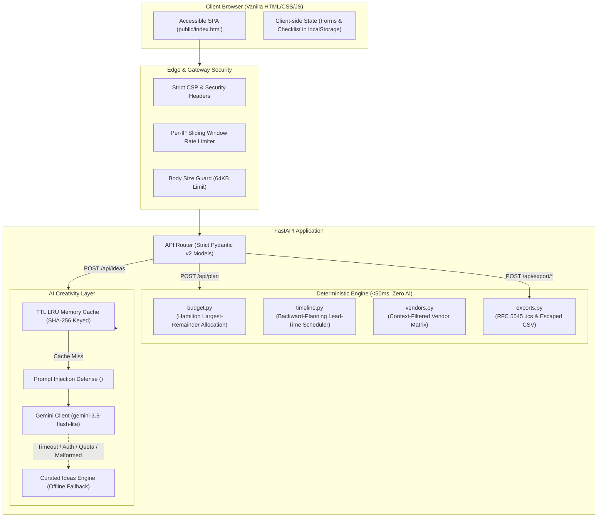
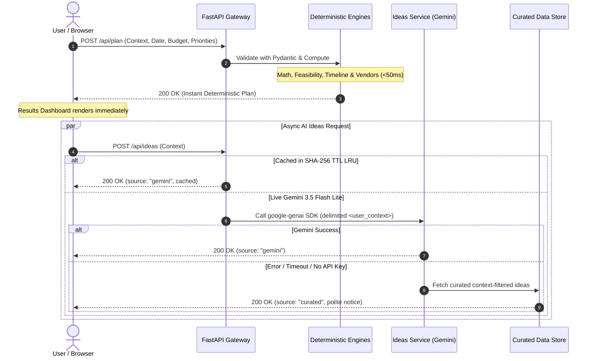

# 🎉 Celebration & Event Planner

> A production-grade GenAI planning assistant that helps you organise weddings, birthdays, and community events — with smart budgets, timelines, vendor checklists, and personalised ideas.

```text
+---------------------------------------------------------------------------------+
|                         CELEBRATION & EVENT PLANNER                             |
|  [💍 Wedding]   [🎂 Birthday]   [🏘️ Community]                                 |
+---------------------------------------------------------------------------------+
|  [ Guided Form ] -> Total Budget, Guests, Priorities, Accessibility, DIY Level  |
|                                                                                 |
|  ============================== PLAN DASHBOARD ==============================  |
|  [ Summary Cards ]  Total Budget  |  Cost / Guest  |  Feasibility  | Days To Go |
|  [ 1. Budget ]      Hamilton Largest-Remainder (Exact integer sum, Contingency) |
|  [ 2. Timeline ]    Backward-Scheduled Milestones, Lead-Time Compression, Runsheet|
|  [ 3. Vendors ]     Context-Filtered Checklist, Book-By Dates, Red Flags, Tasks |
|  [ 4. AI Ideas ]    Gemini 3.5 Flash Lite / Curated Offline Fallback Mode       |
|  [ Actions ]        [ Download .ics ]   [ Export CSV ]   [ Print / PDF ]        |
+---------------------------------------------------------------------------------+
```

**Built for**: Virtual PromptWars — Challenge 5: Celebration & Event Planner

---

## Chosen Vertical

**Celebration & Event Planner** — covering three event categories:

| Type | Persona |
|------|---------|
| 💍 Wedding | Couple planning a wedding 4–18 months out, managing a complex budget and many vendors |
| 🎂 Birthday | Host organising a milestone birthday (child's party to 50th celebration) on any scale |
| 🏘️ Community | Volunteer organiser running a public street party, cultural festival, or neighbourhood fair |

---

## Approach and Logic

### Deterministic Engine + AI Layer

The app uses a **two-layer architecture**:

1. **Deterministic engines** (Python, no network): budget allocation, timeline scheduling, vendor checklist — fast, testable, reliable.
2. **AI layer** (Gemini API): personalisation, themes, invitation text, menu ideas — creative, advisory, gracefully degradable.

**Why the LLM never does arithmetic**: LLMs hallucinate numbers. Budget maths uses the [Hamilton largest-remainder method](https://en.wikipedia.org/wiki/Largest_remainder_method) to guarantee integer allocations that sum _exactly_ to the total — a property that cannot be verified from a probabilistic model. The LLM receives only qualitative tier labels (`moderate/workable`) and never raw numbers to compute with.

### Worked Example 1 — Wedding Budget Context

**Input**: `event_type=wedding, total_budget=25000 USD, guest_count=80, priorities=[food, photography], location_type=outdoor, diy_preference=medium`

**Budget logic**:
- Base wedding weights: venue 30%, catering 28%, photography 12% …
- `photography` priority boost: +8% → renormalise
- `food` priority boost: catering +8% → renormalise
- Outdoor add: `rentals_tent_weather` +6%
- DIY=medium: decor −3%, stationery −1%
- All weights renormalised, contingency floor held at 10%
- Largest-remainder: sum = exactly $25,000 ✓
- Feasibility: $25,000 / 80 = $312/guest → **comfortable** (threshold $300)

**Result**: Photography gets ~$4,100 (boosted from base $3,000). Catering gets ~$8,200. Tent/weather budget $1,500.

### Worked Example 2 — Community Event Compression

**Input**: `event_type=community, event_date=30 days from now, guest_count=200, total_budget=10000 GBP, location_type=outdoor, is_public=True, has_children=True`

**Timeline logic**:
- Ideal lead for community: 84 days. Actual: 30 days → `compressed: True`
- All task offsets multiplied by ratio 30/84 = 0.36
- Tasks that fall in the past are clamped to today → marked `urgent`
- Context tasks injected: permit notification (was day 56 → day 20), weather backup (day 60 → day 22), children's zone (day 30 → day 11)
- Warning: "Your event is 30 days away — less than the recommended 84 days. Tasks marked URGENT need immediate attention."

**Feasibility**: £10,000 / 200 = £50/guest → **tight** (workable threshold £28). Suggestions: reduce to 357 guests at comfortable rate, or increase budget by £5,600 to reach workable.

---

## How It Works

### Architecture Diagram



### Request Flow



### API Endpoints

| Method | Endpoint | Description |
|--------|----------|-------------|
| `GET` | `/healthz` | Health check |
| `POST` | `/api/plan` | Instant deterministic plan (budget + timeline + vendors) |
| `POST` | `/api/ideas` | AI/curated personalised ideas (separate, async) |
| `POST` | `/api/export/ics` | Download calendar file (.ics) |
| `POST` | `/api/export/csv` | Download budget + checklist spreadsheet (.csv) |

---

## Setup & Run

### Prerequisites

- Python 3.11+
- Git

### Local Development

```bash
# 1. Clone
git clone https://github.com/<your-username>/event-planner.git
cd event-planner

# 2. Create virtual environment
python -m venv .venv
.venv\Scripts\activate        # Windows
# source .venv/bin/activate   # macOS/Linux

# 3. Install runtime + dev dependencies
pip install -r requirements-dev.txt

# 4. Configure environment
cp .env.example .env
# Open .env and paste your Gemini API key:
#   GEMINI_API_KEY=your-real-api-key-here
# Optionally change the model:
#   GEMINI_MODEL=gemini-3.5-flash-lite  (default)

# 5. Run the server
uvicorn app.main:app --reload --port 8000

# 6. Open in browser
# http://localhost:8000
```

### Changing the Gemini Model

The default model is `gemini-3.5-flash-lite`. To use a different model:

```bash
# In .env:
GEMINI_MODEL=gemini-3.5-flash

# Or as an environment variable:
GEMINI_MODEL=gemini-3.5-flash uvicorn app.main:app --reload
```

### Without a Gemini API Key

The app works fully without a key. Budget, timeline, and vendor checklist are deterministic and always available. The `/api/ideas` endpoint returns curated ideas with a notice: _"AI ideas are offline. Showing curated ideas tailored to your event."_

### Running Tests

```bash
# All tests
pytest

# With coverage report
pytest --cov=app --cov-report=term-missing

# Lint and format check
ruff check .
ruff format --check .

# Security scans
bandit -r app
pip-audit --requirement requirements.txt
```

---

## Deploy to Vercel

1. Push this repository to GitHub (public repo).
2. Import the repo at [vercel.com/new](https://vercel.com/new).
3. Add environment variables in the Vercel project settings:
   - `GEMINI_API_KEY` → your real key
   - `GEMINI_MODEL` → `gemini-3.5-flash-lite` (or your preferred model)
   - `ENV` → `production`
4. Click **Deploy**.

> **Limitations on Vercel**: The in-memory TTL LRU cache and rate limiter are per-serverless-instance. Across multiple instances they do not share state. For production at scale, use a Redis-backed cache and rate limiter.

---

## Evaluation Criteria Mapping

| Criterion | Evidence |
|-----------|---------|
| **Code Quality** | Clean architecture: pure engine functions, DI for Gemini client, no global mutable state (except documented cache/limiter), `ruff` clean with bugbear + bandit rules, type hints everywhere, docstrings explaining "why". See `app/services/`. |
| **Security** | Strict CSP, security headers middleware, per-IP rate limiter, Pydantic `extra="forbid"`, prompt-injection defence with `<user_context>` delimiters, API key as `SecretStr`, redacted from all logs, secret scan test, `bandit` + `pip-audit` in CI. See `app/security.py`, `docs/SECURITY.md`, `tests/test_security.py`. |
| **Efficiency** | Deterministic plan <50 ms (no network), TTL LRU cache keyed by SHA-256 hash, singleton Gemini client, GZip middleware, data loaded once at startup, 44px touch targets, `prefers-reduced-motion`. See `app/services/ideas.py::_TTLLRUCache`. |
| **Testing** | pytest + coverage ≥90% enforced; 210+ randomised budget sum-invariant cases; Gemini always mocked; prompt-injection tests; schema validation tests; vercel.json header parity test; accessibility HTML structure tests. See `tests/`. |
| **Accessibility** | WCAG 2.2 AA: one H1, `lang` attribute, skip link, semantic landmarks, fieldset/legend, labels for all inputs, `aria-live` regions, focus management after plan load, `prefers-color-scheme`, `prefers-reduced-motion`, print stylesheet, 44px touch targets. See `docs/ACCESSIBILITY.md`, `tests/test_accessibility.py`. |
| **Problem Alignment** | Covers all three required event types (wedding, birthday, community). All four plan components: budget with contingency and feasibility, backward-planned timeline with compression, context-filtered vendor checklist, personalised ideas. What-if controls, export to ICS/CSV, graceful AI degradation. |

---

## Assumptions

1. `gemini-3.5-flash-lite` is the default model constant `DEFAULT_GEMINI_MODEL` (overridable via `GEMINI_MODEL`).
2. Per-guest cost bands are **illustrative** and based on industry estimates: INR ₹800–6,000, USD $50–400, EUR €60–450, GBP £55–400. Actual costs vary significantly by city and vendor.
3. Timeline lead times follow standard industry guidance, not locale-specific rules.
4. The in-memory cache and rate limiter are per-process (documented Vercel limitation).
5. "Community event" permits and insurance requirements follow general best practice — actual requirements vary by jurisdiction.
6. Cultural/religious notes are advisory context only; the AI is instructed not to stereotype.
7. CSV formula-injection protection covers `= + - @` cell starters (the standard OWASP recommendation).
8. ICS PRODID: `-//CelebrationPlanner//Celebration & Event Planner//EN`.

## Limitations

- No persistent storage — vendor status is stored in the browser's `localStorage`.
- No user accounts or authentication.
- Budget amounts are in the selected currency but no real exchange rates are applied.
- Ideas quality depends on the Gemini model and prompt; always verify suggestions.
- Cost bands are illustrative — real prices vary enormously by location and vendor.

---

## Responsible AI Note

All AI-generated suggestions are **advisory only**. Users should:
- Verify vendor availability, prices, and credentials independently.
- Treat budget estimates as a starting framework, not a firm quote.
- Consult a professional event planner for high-value or complex events.

**No personal data is stored by this application.** Form inputs are processed server-side to generate a plan and are not persisted beyond the HTTP request lifetime.
